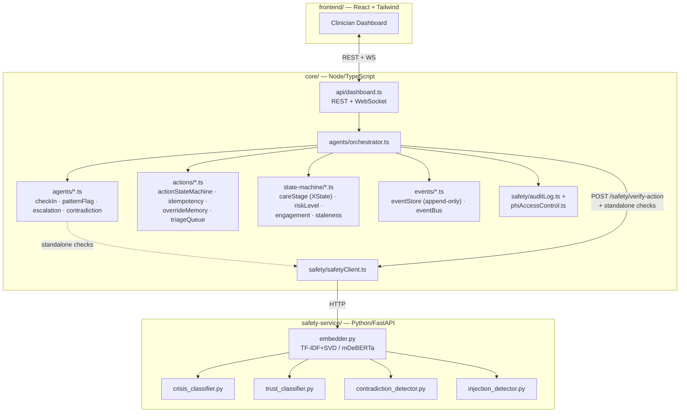

# SAHAYAK — Architecture

## System diagram



## The three world-state dimensions (spec 2.1)

Patient state is modeled as three **independent** dimensions rather than
one linear pipeline — because in real psychiatric care they genuinely
are independent (a patient in `Maintenance` can be in `Crisis`; that's
not a bug to collapse away, it's the actual shape of the domain):

| Dimension | Values | Storage |
|---|---|---|
| `care_stage` | Intake → Active Care → Maintenance → Discharged | Explicit field, XState machine (`state-machine/careStage.ts`) with guarded transitions |
| `risk_level` | Stable / Watch / Crisis | **Computed live** from the event stream on every read (`state-machine/riskLevel.ts`) — never stored |
| `engagement_status` | Active / Unresponsive / Disengaged | **Computed live** from the event stream (`state-machine/engagement.ts`) — never stored |

The event store (`events/eventStore.ts`) is append-only and is the one
source of truth `risk_level` and `engagement_status` are derived from —
there is no field to go stale, because there's no stored field at all.

## Request/action flow

1. An event enters the system (`world.recordEvent`) — a check-in, a
   patient message, a clinician note, a missed check-in.
2. `Orchestrator.handleEvent()` runs the **independent** safety checks
   that apply to every message unconditionally (crisis classifier,
   injection detector — Edge Case 1, guardrail 4.2), before any agent
   sees the event.
3. Each registered agent (`agents/*.ts`) evaluates the event and may
   propose zero or more actions. Agents never decide their own tier,
   never call `POST /safety/verify-action` themselves, and never
   auto-execute anything — they only describe intent
   (`ProposedActionDraft`).
4. The orchestrator resolves the action's tier from the allow-list
   (`agents/actionSchema.ts`), applying any self-correcting downgrade
   from `actions/overrideMemory.ts`.
5. The orchestrator checks source-fact freshness
   (`state-machine/staleness.ts`, Edge Case 3) and calls the safety
   service (`safety/safetyClient.ts`) to verify the action.
6. Based on tier + freshness + safety verdict, the action either
   executes immediately (LOW, MEDIUM) through the idempotency-guarded
   executor (`actions/idempotency.ts`, Edge Case 6), or stays a draft
   in `proposed` status awaiting a clinician (HIGH, or anything
   blocked).
7. Every proposal writes an encrypted, access-controlled reasoning
   trace (`safety/auditLog.ts`, Edge Case 7).
8. The dashboard (`core/src/api/dashboard.ts` → `frontend/`) reads all
   of the above and lets a clinician approve, reject, confirm, or
   dismiss.

## Why split into two services (spec 2.3)

```
┌────────────────────────────┐        ┌────────────────────────────┐
│   CORE PRODUCT (Node/TS)    │  HTTP  │   SAFETY SERVICE (Python)   │
│                              │◄──────►│                              │
│  Event-driven backend        │        │  Encoder-based classifiers  │
│  State machines               │        │  (crisis/trust/contradiction/│
│  Agent orchestration           │        │   injection) — no LLM in    │
│  Action lifecycle                │        │  the loop, no generation     │
└────────────────────────────┘        └────────────────────────────┘
```

The core product matches the target production stack (Node/TypeScript/
Postgres). The safety service is deliberately a separate process, not
a library the core imports: that boundary is what makes "the agent's
own LLM is never the only safety check on itself" (spec 4.2) a
structural property instead of a convention someone could accidentally
violate by importing the wrong module. See `docs/DECISIONS.md` for the
full reasoning.

## Local stand-ins for managed services

Two pieces of the target production stack (AWS EventBridge, Supabase
Realtime) aren't available in this environment, so they're simulated
locally with the same interface a real backend would present, and
documented as swap points rather than silently faked:

| Production | Local stand-in | Where |
|---|---|---|
| AWS EventBridge | In-process `EventEmitter` | `core/src/events/eventBus.ts` |
| Supabase Realtime subscriptions | WebSocket "something changed, refetch" broadcast | `core/src/api/dashboard.ts` |
| Supabase Auth | Single demo clinician principal, auto-granted access on patient admission | `core/src/api/server.ts` |
| Supabase Postgres | In-memory `InMemoryEventStore` implementing the same `EventStore` interface | `core/src/events/eventStore.ts` (schema ready in `core/src/db/schema.sql`) |

## Directory map

```
sahayak/
├── core/                  Node/TypeScript backend
│   ├── src/events/         immutable event log, event bus, event catalog
│   ├── src/state-machine/  care_stage (XState), risk_level, engagement, staleness
│   ├── src/agents/         allow-list, orchestrator, example agents
│   ├── src/actions/        action lifecycle, idempotency, override memory, triage queue
│   ├── src/safety/         safety-service client, PHI access control, audit log
│   ├── src/api/            dashboard REST + WebSocket server
│   └── tests/              83 tests
├── safety-service/        Python/FastAPI encoder-based safety microservice
│   ├── app/                embedder, 4 classifiers, training data, FastAPI app
│   └── tests/               28 tests
├── frontend/              React + TypeScript + Tailwind clinician dashboard
├── eval-harness/          mandatory pre-ship scenario suite (spec 4.3), run against the live system
├── seed-data/             standalone synthetic patient-journey generator (Phase 1)
└── docs/                  this directory
```
